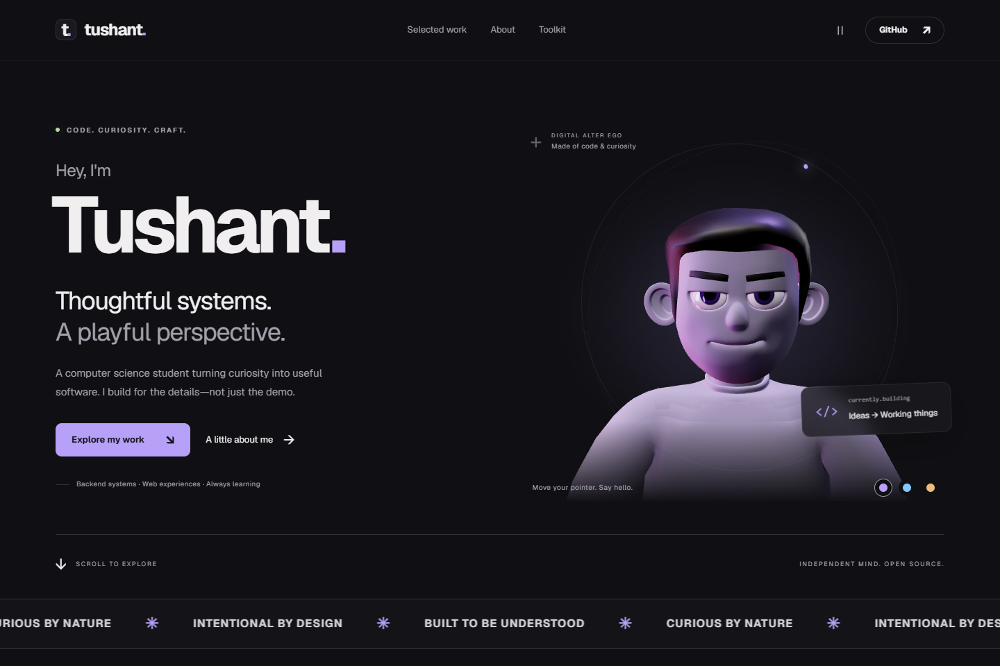
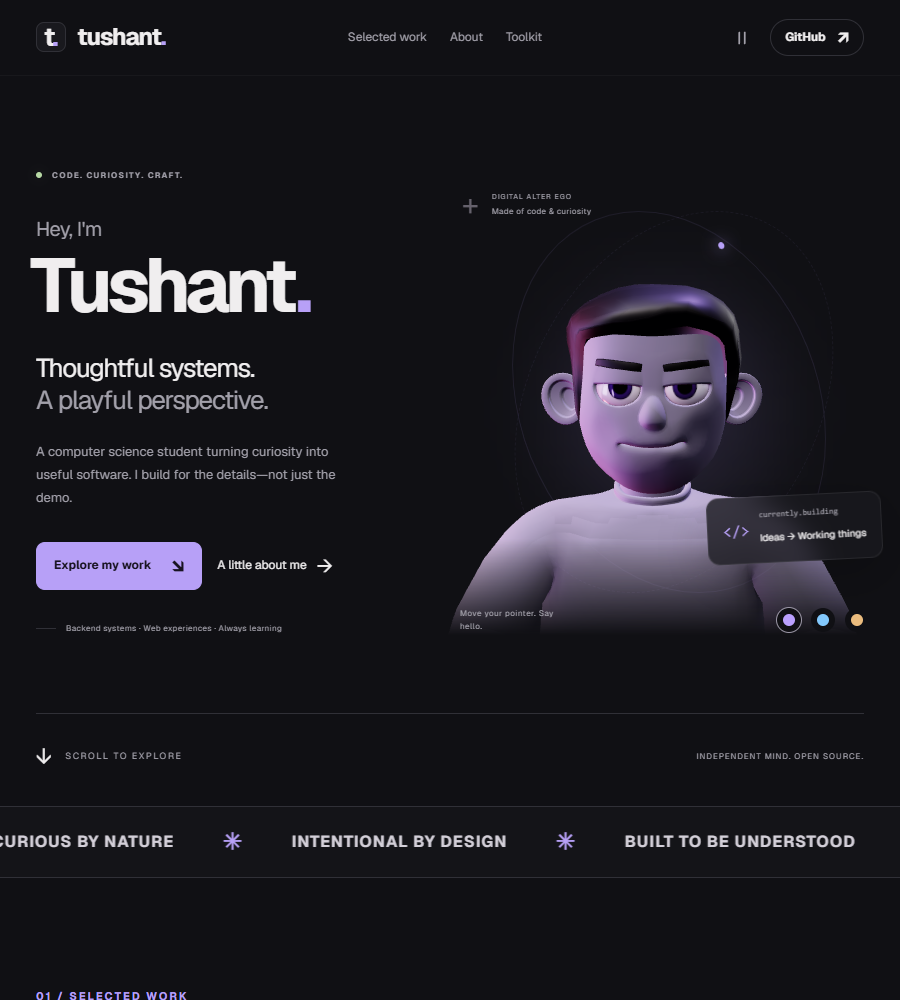
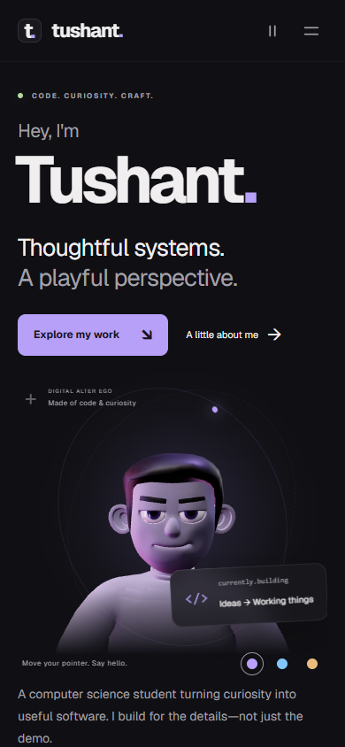
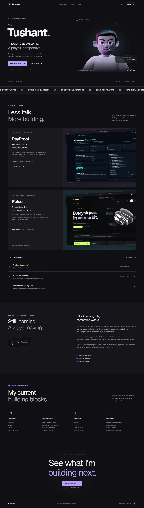
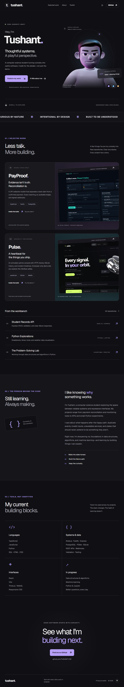
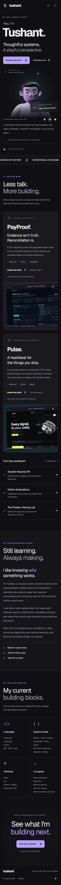
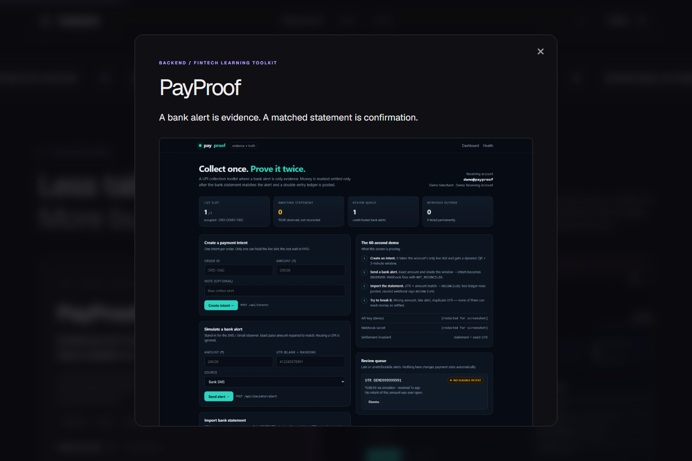
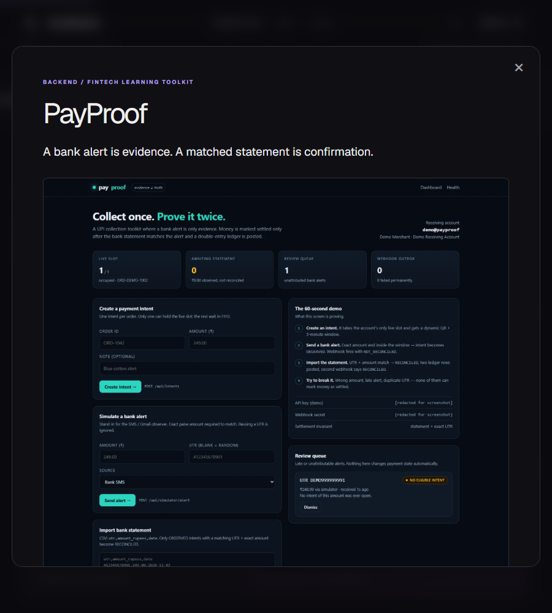
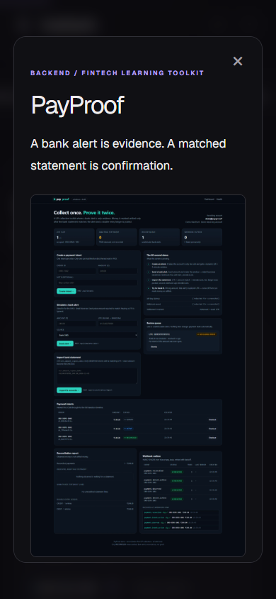

<div align="center">

# Tushant — Digital Workshop

**Thoughtful systems. A playful perspective.**

A custom, privacy-first developer portfolio with an interactive 3D character, honest project stories, and a responsive interface that works without WebGL.




[Explore the work](#featured-projects) · [View screenshots](#screenshots) · [Run locally](#getting-started) · [Read the credits](#credits-and-notices)

</div>

---

## Overview

This portfolio turns a computer science student's learning process into a visual workshop: backend systems, browser experiences, small experiments, and the habits behind them.

The site is intentionally modest about outcomes. PayProof is presented as a fintech learning toolkit rather than a payment gateway, and Pulse uses clearly labeled synthetic monitoring data.

Project information is a verified snapshot dated **November 16, 2026**, not a live GitHub feed.

## Featured projects

| Project | What it is | Boundaries kept clear | Links |
| --- | --- | --- | --- |
| **PayProof** | A bank-alert reconciliation toolkit that connects simulated UPI collections, merchant checks, signed webhooks, and double-entry ledgers. | Teaching-grade demo; not a payment gateway or production payment system. | [Source](https://github.com/TUSHANT-CSE/payproof) |
| **Pulse** | An animated uptime and observability console with safe HTTP checks, SQLite history, incident timelines, and a browser-only demo. | Demo checks and incidents use synthetic data. | [Source](https://github.com/TUSHANT-CSE/pulse) · [Demo](https://tushant-cse.github.io/pulse/) |
| **Student Records API** | An Express CRUD project for practicing REST routes, validation, and clear failure responses. | Learning project; not a live student database. | [Source](https://github.com/TUSHANT-CSE/student-management-zosima) |
| **Python Explorations** | Notebooks and small programs covering fundamentals, data work, and machine-learning exercises. | Educational experiments. | [Source](https://github.com/TUSHANT-CSE/PYTHON) |
| **DSA Problem-Solving Lab** | A growing collection of data-structure and algorithm practice with an emphasis on reasoning. | Practice repository; no invented contest ratings. | [Source](https://github.com/TUSHANT-CSE/tushantDSA) |

## Screenshots

### Responsive views

<p align="center">
  
  
  
</p>

### Full-page layouts

<details>
<summary><strong>Desktop, tablet, and mobile full-page captures</strong></summary>

<br />

**Desktop — 1440px**



**Tablet — 900px**



**Mobile — 390px**



</details>

### Project-detail dialogs

<details>
<summary><strong>PayProof case-study dialog across screen sizes</strong></summary>

<br />

**Desktop**



**Tablet**



**Mobile**



</details>

Project screenshots show synthetic demo data. They are reused from the corresponding public project documentation and resized for this portfolio.

## Features

- **Interactive 3D character** built with Three.js, a locally served GLB model, Draco compression, and local environment lighting.
- **Three lighting moods** with violet, blue, and amber controls.
- **Motion controls** with a persistent in-page preference and full `prefers-reduced-motion` support.
- **Progressive enhancement** so the portfolio content and project links remain usable when JavaScript, WebGL, or the 3D model is unavailable.
- **Lazy scene loading** with data-saver detection, a model-fetch timeout, and WebGL context-loss handling.
- **Native project dialogs** with keyboard support, Escape-to-close, and focus restoration.
- **Responsive layout** tested at desktop, tablet, mobile, and 320px widths.
- **Accessible structure** including a skip link, semantic landmarks, visible focus states, descriptive image text, and labeled controls.
- **Privacy by default** with no analytics, cookies, tracking pixels, contact forms, visitor profiles, or browser-storage APIs.
- **Local runtime assets** for fonts, images, the 3D model, and the Draco decoder. External sites load only after a visitor follows a link.

## Tech stack

| Area | Tools |
| --- | --- |
| Language | JavaScript ES modules |
| Build tooling | Vite 8 |
| 3D rendering | Three.js, WebGL, GLTFLoader, DRACOLoader, RGBELoader |
| Interface | Semantic HTML, responsive CSS, native `<dialog>` |
| Browser APIs | IntersectionObserver, ResizeObserver, AbortController |
| Assets | Geist fonts, local GLB/HDR files, WebP screenshots |
| Backend | None required |

## Getting started

### Requirements

- Node.js **22.12+** recommended
- npm

No API keys, environment variables, database, or external services are required.

### Install

```bash
npm ci
```

### Start the development server

```bash
npm run dev
```

Open `http://127.0.0.1:5177/`.

### Create a production build

```bash
npm run check
npm run build
```

The static site is generated in `dist/`.

### Preview the production build

```bash
npm run preview
```

Open `http://127.0.0.1:4177/`.

## Scripts

| Command | Purpose |
| --- | --- |
| `npm run dev` | Start the local Vite development server on port `5177`. |
| `npm run check` | Check the JavaScript source files for syntax errors. |
| `npm run build` | Create the production build in `dist/`. |
| `npm run preview` | Serve the production build locally on port `4177`. |

## Project structure

```text
.
├── docs/
│   └── screenshots/
├── public/
│   ├── draco/
│   ├── fonts/
│   ├── images/
│   └── models/
├── src/
│   ├── content.js
│   ├── main.js
│   ├── scene.js
│   └── style.css
├── index.html
├── package.json
├── package-lock.json
└── vite.config.js
```

## Privacy and accessibility

The public profile intentionally contains only a first name, professional project information, and GitHub links. It does not include a personal email address, phone number, exact location, college details, or private photographs.

Search indexing is disabled with `noindex,nofollow`, outbound links use `no-referrer`, and motion preferences stay in memory only while the page is open. The current hosted preview is access-controlled; this public repository is the source and documentation.

## Validation completed

- Production build and JavaScript syntax checks pass.
- Desktop `1440px`, tablet `900px`, mobile `390px`, and narrow `320px` layouts checked.
- No horizontal page overflow or text overflow in the tested layouts.
- No JavaScript console errors during the tested flows.
- Motion toggle, lighting controls, project dialogs, privacy dialog, and focus restoration checked.
- Reduced-motion behavior checked.
- Model-failure, data-saver, and WebGL context-loss fallbacks checked.
- No cookies, local-storage entries, analytics requests, or external runtime asset requests observed.

## Credits and notices

- **Custom layout, interactions, and copy:** created for Tushant's portfolio.
- **Project screenshots:** from Tushant's public PayProof and Pulse repositories; they show synthetic demonstration data.
- **3D character and environment:** reused from Redoyanul Haque's supplied MIT-licensed portfolio archive. The character is fictional, not a photograph of Tushant. The supplied notice is retained in [public/models/LICENSE.txt](public/models/LICENSE.txt).
- **Avatar provenance:** the upstream model-specific rights have not been independently verified. Review those rights before commercial use or further redistribution.
- **Three.js:** MIT License — [notice](public/THREE-LICENSE.txt).
- **Draco decoder:** Apache License 2.0 — [notice](public/draco/LICENSE.txt).
- **Geist font:** SIL Open Font License 1.1 — [notice](public/fonts/OFL.txt).

Full provenance and privacy notes are available in [public/credits.txt](public/credits.txt).

## Connect

**GitHub:** [@TUSHANT-CSE](https://github.com/TUSHANT-CSE)

The portfolio deliberately keeps contact GitHub-only.
